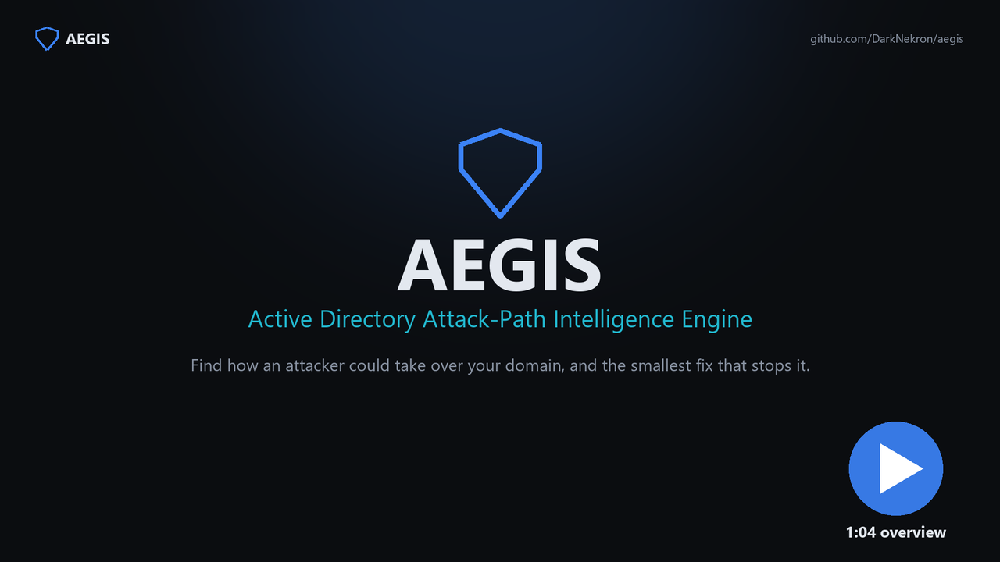
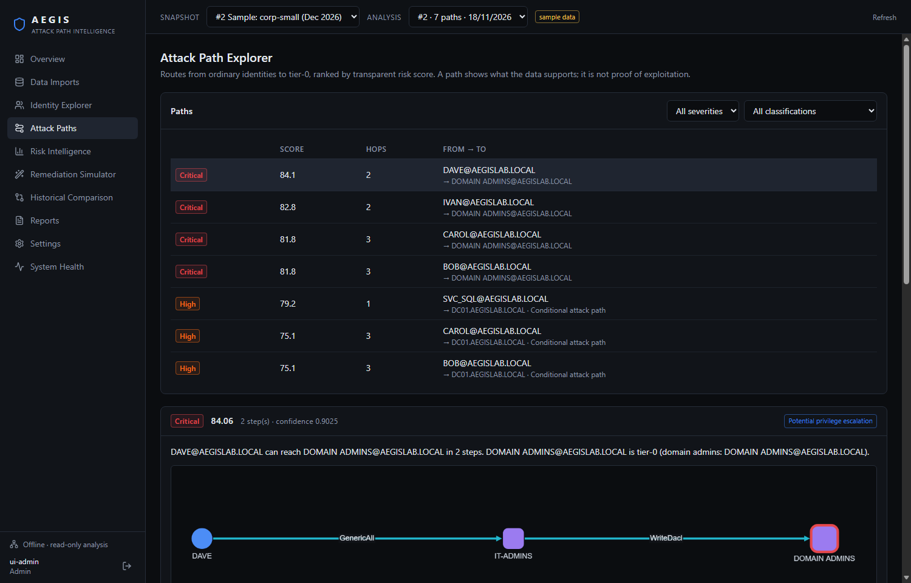
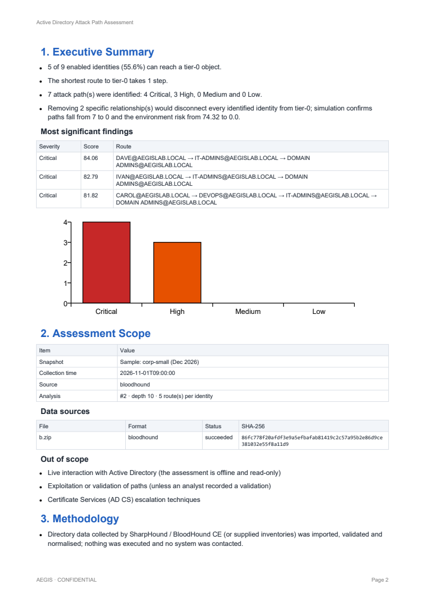

# AEGIS
### Active Directory Attack Path Discovery & Intelligence Engine

AEGIS is an offline, read-only analysis platform for Active Directory security. It ingests data that was already
collected, from SharpHound / BloodHound CE or your own inventories, and rebuilds the directory as a graph. With its
**own** algorithms it then finds every route from ordinary identities to tier-0. Each path is explained and scored
transparently. AEGIS also computes the smallest set of fixes that breaks every path, simulates remediation before
you change anything, compares assessments over time and produces penetration-test reports.

**▶ Watch the 1-minute narrated overview:**

[](docs/media/aegis-overview.mp4)


> AEGIS never connects to, collects from or modifies a directory. Use it only on data from environments you are
> authorised to assess. Screenshots show the bundled **synthetic** `AEGISLAB.LOCAL` sample data.

## What it does

| | |
|---|---|
| **Ingestion** | SharpHound / BloodHound CE JSON and ZIP (v4–v6), AEGIS JSON and CSV inventories. Streaming parser, flat memory. ZIPs are validated against traversal, symlinks, bombs and encryption, and never extracted. Imports are atomic, with item-level error reporting. |
| **Graph construction** | A rules table per relationship type **and target kind** (e.g. GenericWrite on a group is a member add, on a user it is shadow credentials, which is conditional). Tier-0 classification with a recorded reason per object. DCSync derived only when both rights are present. |
| **Attack paths** | Reverse multi-source Dijkstra (every identity in one pass), Yen's k-shortest alternatives, bounded DFS, **Edmonds–Karp minimum cut**, sampled Brandes centrality. Every path is explained step by step with the conditions to validate. Paths are never reported as "exploited". |
| **Risk scoring** | A nine-factor additive model with a per-factor breakdown that sums to the score. Configurable weights. Conditional paths are capped at High until validated. A monotone environment score. See [RISK_SCORING.md](docs/RISK_SCORING.md). |
| **Remediation simulation** | Remove relationships, memberships, ACLs, admin rights or sessions, disable identities, or apply the minimum cut, all on an isolated view of the graph, with before/after paths, exposure and risk. |
| **Historical comparison** | Objects, relationships, privilege, attack paths and risk between snapshots, matched on SIDs and GUIDs, so renames are tracked. |
| **Reports** | PDF, HTML and JSON with 13 sections (executive summary to conclusion), evidence tables, and a minimum-cut recommendation backed by simulation. |
| **Built-in guide** | **Nekron**, a step-by-step walkthrough of every page. It opens on each user's first sign-in and can be skipped. Call it back any time with the sidebar *Nekron · Help* button, the floating moon button, or the `?` key. On a page, it opens that page's help. |
| **Security** | Argon2id, server-side hashed sessions, CSRF tokens, admin / analyst / viewer roles, rate limiting, lockout, audit log, strict CSP, no default credentials. See [SECURITY.md](docs/SECURITY.md). |

| Attack Path Explorer | Identity Explorer |
|---|---|
|  |  |
| **Historical Comparison** | **PDF report** |
|  |  |

## Quick start (Windows)

Requirements: Python 3.12, Node.js ≥ 20.19 and Git. No administrator rights, no Docker, no database server.

```powershell
git clone <repository-url> aegis; cd aegis
powershell -ExecutionPolicy Bypass -File scripts\setup.ps1 -Admin admin   # venv, dependencies, UI build, .env, first admin
powershell -ExecutionPolicy Bypass -File scripts\load_sample_data.ps1    # optional: synthetic sample environment
powershell -ExecutionPolicy Bypass -File scripts\run_backend.ps1         # then open http://127.0.0.1:8000
```

New to AEGIS? Sign in and **Nekron**, the built-in guide, walks you through each page.

On a fresh clone, setup finished in **78 s** on the development laptop. Details, Linux and macOS steps, and Docker are in
[INSTALLATION.md](docs/INSTALLATION.md).

## Verified, not assumed
* **326 automated tests** with 97% backend coverage, covering every module, the API, roles and CSRF.
* **Ground truth:** hand-derived answer keys for the sample datasets (paths, choke point, a unique 4-edge minimum cut,
  simulations, v1→v2 changes) are re-derived by an independent reference implementation, and the engine must match them.
* **Property tests:** 40 random graphs checked against NetworkX and brute-force oracles for shortest paths, Yen,
  exhaustive enumeration, max-flow and betweenness.
* **Measured performance** on a 16 GB laptop: a 20,000-user domain (27.6k objects, 114k relationships) imports in about 18 s.
  The graph builds in 0.67 s, the analysis runs in 0.67 s and a full what-if simulation in 0.54 s, with a peak of 267 MB
  for the whole process. See [BENCHMARKS.md](docs/BENCHMARKS.md).
* **Browser check:** headless Edge walkthrough of every page found no console exceptions and no CSP violations.

## Documentation
| Topic | Document |
|---|---|
| Installation and configuration | [INSTALLATION.md](docs/INSTALLATION.md) |
| Architecture and design decisions | [ARCHITECTURE.md](docs/ARCHITECTURE.md) |
| HTTP API | [API.md](docs/API.md) (interactive docs at `/api/docs` in development) |
| Import formats | [DATA_FORMATS.md](docs/DATA_FORMATS.md) |
| Risk model | [RISK_SCORING.md](docs/RISK_SCORING.md) |
| Security model | [SECURITY.md](docs/SECURITY.md) |
| Sample datasets and ground truth | [sample_data/README.md](sample_data/README.md) |
| Development | [DEVELOPER_GUIDE.md](docs/DEVELOPER_GUIDE.md) |
| Testing | [TESTING.md](docs/TESTING.md) |
| Benchmarks | [BENCHMARKS.md](docs/BENCHMARKS.md) |
| Troubleshooting | [TROUBLESHOOTING.md](docs/TROUBLESHOOTING.md) |
| Hardware assessment and roadmap | [SYSTEM_ASSESSMENT.md](docs/SYSTEM_ASSESSMENT.md) · [DEVELOPMENT_ROADMAP.md](docs/DEVELOPMENT_ROADMAP.md) |

## Technology
Python 3.12 · FastAPI · Pydantic · SQLAlchemy 2 · Alembic · SQLite (WAL) · NetworkX (as a data structure) · ijson ·
Argon2 · ReportLab · Jinja2 · React 19 · TypeScript 7 · Vite 8 · Tailwind CSS 4 · Cytoscape.js · Recharts

## License
MIT. See [LICENSE](LICENSE).
