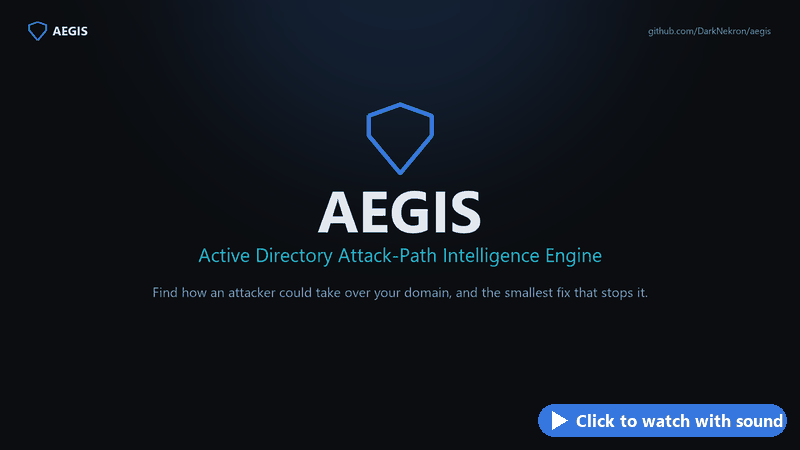
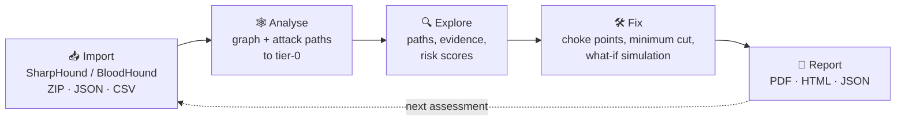
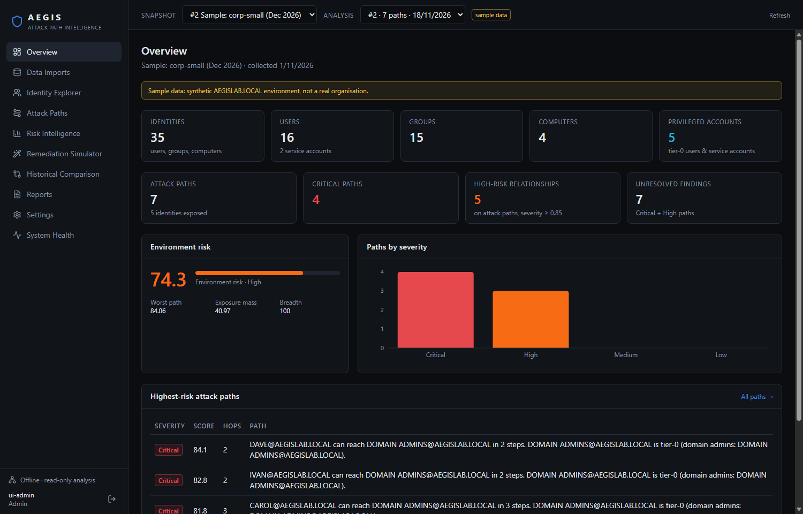
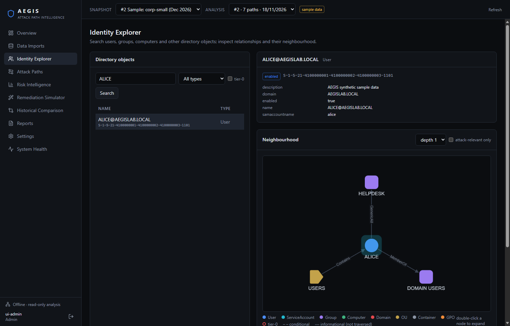
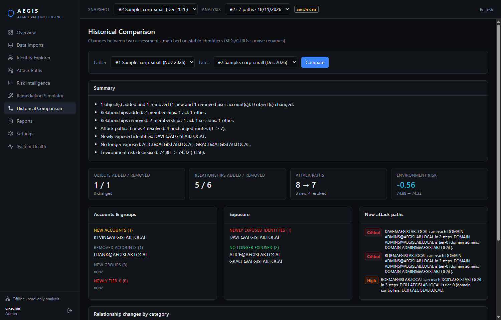
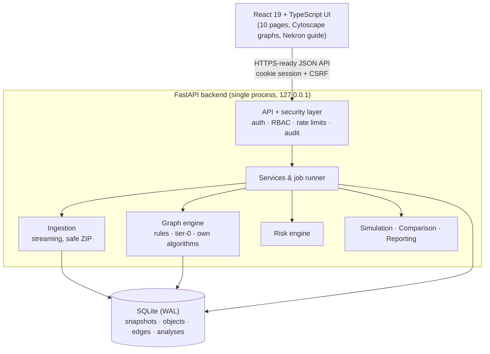

<div align="center">

# 🛡️ AEGIS

### Active Directory Attack Path Discovery & Intelligence Engine

**Find out how an attacker could take over your Active Directory domain, and the smallest set of fixes that stops them.**


<a href="docs/media/aegis-overview.mp4"></a>

**▶ [Watch the full 1-minute narrated video (with sound)](docs/media/aegis-overview.mp4)**

</div>

---

## Contents
[What is AEGIS?](#what-is-aegis) · [How it works](#how-it-works) · [Features](#features) · [Screenshots](#screenshots) ·
[Quick start](#quick-start) · [Signing in](#signing-in-no-default-passwords) · [Security](#security) ·
[Verified, not assumed](#verified-not-assumed) · [Architecture](#architecture) · [Documentation](#documentation)

## What is AEGIS?

In Active Directory, attackers rarely need a "hack". They chain permissions that already exist. For example, Bob can
reset Alice's password, Alice is in a group that can edit Domain Admins, so Bob is effectively a domain admin.
These chains are called **attack paths**, and real domains contain thousands of them.

AEGIS is an **offline, read-only** analysis platform that:

* **ingests** data you already collected (SharpHound / BloodHound CE, or your own CSV/JSON inventories),
* **finds every attack path** from ordinary accounts to **tier-0** (the most powerful accounts and servers), using
  its **own** graph algorithms,
* **explains and scores** each path transparently, with no black box,
* computes the **smallest set of fixes** that breaks *every* path, and lets you **simulate** them first,
* **tracks progress** between assessments and produces **professional reports**.

> AEGIS never connects to, collects from or modifies a directory. Use it only on data from environments you are
> authorised to assess. All screenshots show the bundled **synthetic** `AEGISLAB.LOCAL` sample data.

## How it works



## Features

| | |
|---|---|
| 📥 **Ingestion** | SharpHound / BloodHound CE JSON and ZIP (v4–v6), AEGIS JSON and CSV inventories. Streaming parser with flat memory use. ZIPs are checked for traversal, symlinks, zip bombs and encryption, and are never extracted to disk. Imports are atomic, with errors reported per item. |
| 🕸️ **Graph construction** | A rules table per relationship type **and target kind**. For example, GenericWrite on a group means "add a member", but on a user it means shadow credentials, which is conditional. Every tier-0 object records why it is tier-0. DCSync is derived only when both required rights are present. |
| 🧭 **Attack paths** | Reverse multi-source Dijkstra (every identity in one pass), Yen's k-shortest alternatives, bounded DFS, **Edmonds–Karp minimum cut** and sampled Brandes centrality. Every path is explained step by step in plain English, with the conditions to validate. Paths are never reported as "exploited". |
| 📊 **Risk scoring** | A nine-factor additive model whose per-factor breakdown always sums to the score. Configurable weights. Conditional paths are capped at High until validated. The environment score is monotone: removing access can never raise it. [Details](docs/RISK_SCORING.md). |
| 🛠️ **Remediation simulator** | Remove relationships, memberships, ACLs, admin rights or sessions, disable identities, or apply the minimum cut. Everything runs on an isolated in-memory view and shows paths, exposure and risk before and after. |
| 📈 **Historical comparison** | Compares objects, relationships, privilege, attack paths and risk between snapshots. Matching uses SIDs and GUIDs, so renamed accounts are tracked correctly. |
| 📄 **Reports** | PDF, HTML and JSON with 13 sections (executive summary to conclusion), evidence tables, and a minimum-cut recommendation backed by simulation. |
| 🌙 **Built-in guide: Nekron** | A friendly step-by-step tour of every page. It opens on each user's first sign-in and can be skipped. Call it back any time with the sidebar **Nekron · Help** button, the floating moon button, or the **`?`** key. Called from a page, it opens that page's help. |
| 🔐 **Security** | No default passwords: you create your own admin on first run. Argon2id, server-side sessions, CSRF tokens, admin / analyst / viewer roles, rate limiting, lockout, audit log, strict CSP. [Details](#security). |

## Screenshots

| Overview dashboard | Attack Path Explorer |
|---|---|
|  |  |
| **Identity Explorer** | **Historical Comparison** |
|  |  |

<details>
<summary><b>PDF report sample</b></summary>


</details>

## Quick start

**Requirements:** Windows 10/11, Python 3.12, Node.js ≥ 20.19 and Git. No administrator rights, no Docker and no
database server are needed. Linux, macOS and Docker steps are in [INSTALLATION.md](docs/INSTALLATION.md).

```powershell
git clone https://github.com/DarkNekron/aegis.git
cd aegis
powershell -ExecutionPolicy Bypass -File scripts\setup.ps1             # Python venv, dependencies, UI build, .env with a random secret key
powershell -ExecutionPolicy Bypass -File scripts\load_sample_data.ps1  # optional: synthetic practice domain
powershell -ExecutionPolicy Bypass -File scripts\run_backend.ps1       # start AEGIS
```

Then open **<http://127.0.0.1:8000>** and follow the first-run screen (next section). On a fresh clone, setup took
**78 s** on the development laptop.

> `-ExecutionPolicy Bypass` applies only to that one PowerShell process. It changes no system setting. The scripts are
> short, so read them first if you like.

## Signing in: no default passwords

AEGIS ships with **no accounts and no default credentials**, so nobody can sign in with a well-known password.

**First run.** When AEGIS starts with no accounts, it prints a one-time **setup code** in the server window:

```
================================================================
  AEGIS FIRST-RUN SETUP
  No accounts exist yet. Open AEGIS in your browser and enter this
  one-time setup code to create your administrator account:

      N6ZS-Z2D7-8Y3P-3YWT
================================================================
```

1. Open <http://127.0.0.1:8000>. You see **Create your administrator account**.
2. Enter the setup code, then choose **your own** username and password. A live checklist shows the password rules.
3. You are signed in as the administrator. The setup screen is locked for good.
4. Add colleagues under **Settings → Users** as *Viewer* (read-only), *Analyst* (import, analyse, simulate, report)
   or *Admin*.

**Every time after that,** the page shows the normal sign-in form (username and password, with a show/hide toggle).
Forgotten passwords are reset by an administrator.

Why a setup code? Without one, whoever opened the page first could claim the installation. The code proves you
control the machine AEGIS runs on. It is also saved to `data\first-run-setup-code.txt` in case the window is hidden.
It works once, is deleted after setup, and changes on every restart until setup is done.

## Security

| Area | What AEGIS does |
|---|---|
| **Passwords** | Stored only as salted **Argon2id** hashes (t=3, 64 MiB, p=4), never in plain text. 12–128 characters, must not contain the username, common or repetitive passwords rejected. Hashes are upgraded on login when parameters change. |
| **First run** | No default accounts. The first admin needs a one-time, single-use console code (~79 bits). Only its SHA-256 is kept and comparison is constant-time. Attempts are rate-limited and audited. Setup is refused once any account exists. |
| **Sign-in** | The same error for every failure (no username discovery, timing equalised). Lockout after 5 failures, plus rate limits per IP and per username. |
| **Sessions** | Random tokens stored hashed on the server. HttpOnly, SameSite=Strict cookies. Idle and absolute expiry. A password change revokes other sessions. |
| **Requests** | CSRF token and Origin check on every change. Role checks on every endpoint. Strict Content-Security-Policy. |
| **Data** | Imported data is treated as untrusted: length caps, escaping in the UI and reports, safe ZIP handling. Runs on loopback (127.0.0.1) by default. |
| **Accountability** | Audit log of sign-ins, setup, imports, analyses, simulations, reports, settings and user changes. |

Password-based sign-in is the only method today. The session layer is separate from the password check, so
single sign-on or MFA can be added later without redesign. The full threat model is in [SECURITY.md](docs/SECURITY.md).

## Verified, not assumed

* **338 automated tests** with **97%** backend coverage, covering every module, the API, roles, CSRF and first-run
  setup.
* **Ground truth:** hand-derived answer keys for the sample datasets (paths, choke point, a unique 4-edge minimum cut,
  simulations, v1→v2 changes) are re-derived by an independent reference implementation, and the engine must match them.
* **Property tests:** 40 random graphs are checked against NetworkX and brute-force oracles for shortest paths, Yen,
  exhaustive enumeration, max-flow and betweenness.
* **Measured performance** on a 16 GB laptop: a **20,000-user domain** (27.6k objects, 114k relationships) imports in
  about 18 s. The graph builds in 0.67 s, the analysis runs in **0.67 s** and a full what-if simulation in 0.54 s, with a
  267 MB peak for the whole process. See [BENCHMARKS.md](docs/BENCHMARKS.md).

## Architecture



Design decisions and their reasons are documented in [ARCHITECTURE.md](docs/ARCHITECTURE.md).

## Documentation

| Topic | Document |
|---|---|
| Installation, first run and configuration | [INSTALLATION.md](docs/INSTALLATION.md) |
| Architecture and design decisions | [ARCHITECTURE.md](docs/ARCHITECTURE.md) |
| Security model | [SECURITY.md](docs/SECURITY.md) |
| HTTP API | [API.md](docs/API.md) (interactive docs at `/api/docs` in development) |
| Import formats | [DATA_FORMATS.md](docs/DATA_FORMATS.md) |
| Risk model | [RISK_SCORING.md](docs/RISK_SCORING.md) |
| Sample datasets and ground truth | [sample_data/README.md](sample_data/README.md) |
| Development | [DEVELOPER_GUIDE.md](docs/DEVELOPER_GUIDE.md) |
| Testing | [TESTING.md](docs/TESTING.md) |
| Benchmarks | [BENCHMARKS.md](docs/BENCHMARKS.md) |
| Troubleshooting | [TROUBLESHOOTING.md](docs/TROUBLESHOOTING.md) |
| Hardware assessment and roadmap | [SYSTEM_ASSESSMENT.md](docs/SYSTEM_ASSESSMENT.md) · [DEVELOPMENT_ROADMAP.md](docs/DEVELOPMENT_ROADMAP.md) |

## Technology

**Backend:** Python 3.12 · FastAPI · Pydantic · SQLAlchemy 2 · Alembic · SQLite (WAL) · NetworkX (as a data structure
only) · ijson · Argon2 · ReportLab · Jinja2
**Frontend:** React 19 · TypeScript 7 · Vite 8 · Tailwind CSS 4 · Cytoscape.js · Recharts

## Responsible use

AEGIS is a defensive and assessment tool. Analyse only data from environments you own or are explicitly authorised
to assess. An attack path shows what the collected data allows. It is not proof that it has been exploited.

## License

MIT. See [LICENSE](LICENSE).
